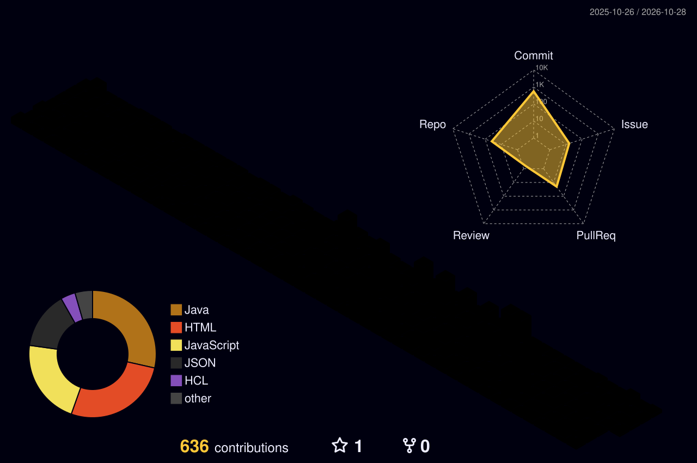

<div align="center">


<a href="https://git.io/typing-svg" target="_blank">
  
</a>

<br/>

<a href="https://linkedin.com/in/shyambaranwal" target="_blank"></a>
<a href="mailto:baranwal07shyam@gmail.com" target="_blank"></a>
<a href="https://leetcode.com/u/shyam-medh" target="_blank"></a>
<a href="https://codolio.com/profile/Shyam_" target="_blank"></a>

<br/>


</div>

---

## 👋 About Me

<table>
<tr>
<td width="55%" valign="top">

### Hi, I'm Shyam Baranwal

I'm a **B.Tech CSE student** at Lovely Professional University who lives in the space between writing code and shipping it — which is exactly where **DevOps** lives.

I architect production-grade AWS pipelines with **Terraform**, **Kubernetes**, and **Jenkins**. I believe infrastructure should be as clean and testable as code.

> 🌱 Currently exploring: Generative AI, RAG & AI Agents · Kubernetes internals · Advanced AWS
>
> 🎯 2026 Goals: **AWS SAA ✅ · AZ-104 ✅ · AWS CCP ✅ · More Open Source**
>
> ⚡ Fun fact: Solved 800+ DSA problems & still debug with `print()` 😄

</td>
<td width="45%" valign="top">


</td>
</tr>
</table>

---

## 🛠️ Tech Stack

<div align="center">

### Languages


### Frameworks & Backend


### DevOps & Cloud


### Monitoring & Databases


<br/>

**☁️ AWS Services**

<table>
  <tr>
    <td align="center" width="40">
      <br/><sub><b>EC2</b></sub>
    </td>
    <td align="center" width="40">
      <br/><sub><b>S3</b></sub>
    </td>
    <td align="center" width="40">
      <br/><sub><b>RDS</b></sub>
    </td>
    <td align="center" width="40">
      <br/><sub><b>Lambda</b></sub>
    </td>
    <td align="center" width="40">
      <br/><sub><b>CloudWatch</b></sub>
    </td>
    <td align="center" width="40">
      <br/><sub><b>VPC</b></sub>
    </td>
    <td align="center" width="40">
      <br/><sub><b>IAM</b></sub>
    </td>
    <td align="center" width="40">
      <br/><sub><b>EKS</b></sub>
    </td>
    <td align="center" width="40">
      <br/><sub><b>ECR</b></sub>
    </td>
    <td align="center" width="40">
      <br/><sub><b>ALB</b></sub>
    </td>
  </tr>
</table>

<br/>

**🔷 Azure Services**

<table>
  <tr>
    <td align="center" width="40">
      <br/><sub><b>AKS</b></sub>
    </td>
    <td align="center" width="40">
      <br/><sub><b>VMs</b></sub>
    </td>
    <td align="center" width="40">
      <br/><sub><b>Entra ID</b></sub>
    </td>
    <td align="center" width="40">
      <br/><sub><b>VNets</b></sub>
    </td>
    <td align="center" width="40">
      <br/><sub><b>NSGs</b></sub>
    </td>
    <td align="center" width="40">
      <br/><sub><b>Storage</b></sub>
    </td>
    <td align="center" width="40">
      <br/><sub><b>Azure Monitor</b></sub>
    </td>
  </tr>
</table>


**🔒 Security & Quality**

<table>
  <tr>
    <td align="center" width="40">
      <br/><sub><b>Checkov</b></sub>
    </td>
    <td align="center" width="40">
      <br/><sub><b>SonarQube</b></sub>
    </td>
    <td align="center" width="40">
      <br/><sub><b>Trivy</b></sub>
    </td>

  </tr>
</table>

</div>

---

## 💼 Work Experience

<div align="center">

&nbsp;

&nbsp;

</div>

<br/>

<table>
<tr>
<td>🤝 <b>Agile Collaboration</b></td>
<td>Live client projects in Agile sprints — working with developers, testers & stakeholders</td>
</tr>
<tr>
<td>⚙️ <b>Full-Stack Dev</b></td>
<td>End-to-end web apps with <b>Python, Django, JavaScript, HTML & CSS</b></td>
</tr>
<tr>
<td>🔌 <b>API & Performance</b></td>
<td>Designed RESTful APIs, DB optimization, application performance improvements</td>
</tr>
<tr>
<td>🛠️ <b>Tools & Quality</b></td>
<td><b>Git, JIRA, SonarQube</b> — version control, sprint tracking, code quality</td>
</tr>
</table>

---

## 🏗️ Featured Projects

<table>
<tr>
<td width="100%" valign="top">

### ☁️ Code-To-Cloud: Enterprise DevSecOps

<a href="https://github.com/shyam-medh/Code-To-Cloud" target="_blank"></a>
&nbsp;
<a href="https://github.com/shyam-medh/Code-To-Cloud" target="_blank"></a>

Production-grade, zero-trust DevSecOps pipeline with **immutable infrastructure** and **automated rolling deployments**.

```
GitHub Push
    ↓ Security Gate 1: Checkov (IaC Scan) + SonarQube (Static Analysis)
    ↓ Security Gate 2: Docker Multi-Stage Build + Trivy Image CVE Scan
    ↓ AWS ASG Instance Refresh (Zero-Downtime Rollout)
    → Health-Checked Production Deployment 🚀
```

✅ **100% IaC**: 7 modular Terraform components across dual-VPC architecture  
✅ **3-Tier DevSecOps**: Comprehensive pre-merge policy checks & container vulnerability scans  
✅ **Optimized Footprint**: 75% image size reduction using distroless multi-stage Docker builds  
✅ **High Availability**: Zero-downtime rolling updates managed via AWS Auto Scaling Groups  

`AWS` `Terraform` `Jenkins` `Docker` `Checkov` `SonarQube` `Trivy` `DevSecOps`

</td>
</tr>
<tr>
<td width="100%" valign="top">

### ☁️ Cloud-Native DevOps (EKS + Fargate)

<a href="https://github.com/shyam-medh/cloud-native-devops-platform" target="_blank"></a>
&nbsp;
<a href="https://github.com/shyam-medh/cloud-native-devops-platform" target="_blank"></a>

Fully serverless container orchestration on AWS EKS Fargate with **GitOps CI/CD** and **AI-driven automated incident remediation**.

```
EKS Fargate Cluster (6 Modular Terraform Stacks)
    ↓ Jenkins via Helm Charts → AWS ECR Private Registry
    ↓ Full Observability: Prometheus Metrics + Grafana Dashboards
    → Robusta AI SRE Agent (Automated CrashLoop & Anomaly Remediation) 🤖
```

✅ **Serverless Compute**: Fully managed AWS Fargate pods — eliminates node management overhead  
✅ **Reproducible GitOps**: Helm-orchestrated Jenkins workflows stored version-controlled as code  
✅ **AI-Assisted Operations**: Automated root-cause diagnostics and pod self-healing via Robusta AI  
✅ **Enterprise Monitoring**: End-to-end telemetry with real-time alerting on cluster anomalies  

`AWS EKS` `Fargate` `Terraform` `Helm` `Prometheus` `Grafana` `Robusta AI`

</td>
</tr>
<tr>
<td width="100%" valign="top">

### 🎓 Role-Based Student Management System

<a href="https://github.com/shyam-medh/Library-Management-Sys" target="_blank"></a>
&nbsp;
<a href="https://github.com/shyam-medh/Library-Management-Sys" target="_blank"></a>

Enterprise-grade desktop management platform built with **strict RBAC permission gating** and high-throughput database connection pooling.

```
Desktop Client UI (Swing / Java)
    ↓ Authentication & RBAC Gate (Admin · Faculty · Student)
    ↓ Optimized HikariCP Connection Pool → Indexed MySQL (3NF)
    → ACID-Compliant Transactions & Tamper-Proof Audit Logs 🔒
```

✅ **Granular Authorization**: 3 strictly isolated user roles with UI-level and query-level permission gates  
✅ **Optimized Database Layer**: 500+ records in a 3NF normalized MySQL database with B-tree indexing  
✅ **High Performance**: Connection pooling architecture to handle concurrent reads/writes with low latency  
✅ **Measurable Impact**: 40% reduction in administrative processing time · 30% fewer data-entry discrepancies  

`Java Swing` `JDBC` `HikariCP` `MySQL` `RBAC` `Security`

</td>
</tr>
<tr>
<td width="100%" valign="top">

### 🤖 Stock Analysis Agent: AI Multi-Tool & RAG

<a href="https://github.com/shyam-medh/Stock-Analysis-Agent" target="_blank"></a>
&nbsp;
<a href="https://github.com/shyam-medh/Stock-Analysis-Agent" target="_blank"></a>

Autonomous financial intelligence agent built with **Google ADK**, **OpenRouter**, and **Alpha Vantage** — combining real-time retrieval-augmented generation (RAG) with agentic tool calling.

```
User Query (Natural Language Prompt)
    ↓ Google ADK Agent (Autonomous Tool Selection & Planning)
    ↓ Financial RAG: Real-Time Price Ingestion & Market News Search (Alpha Vantage)
    → Multi-Model LLM Reasoning & Sentiment Synthesis (OpenRouter) 🤖
```

✅ **Agentic Workflow**: Autonomous multi-turn planning loop executing tools and synthesizing responses  
✅ **5 Specialized FunctionTools**: Ticker discovery, live quotes, technical indicators, news, and sentiment  
✅ **Real-Time Financial RAG**: Dynamic context retrieval injected directly into the LLM reasoning window  
✅ **Multi-Model Orchestration**: Leverages OpenRouter to route complex queries across leading frontier models  

`Python` `Google ADK` `Agentic AI` `RAG` `OpenRouter` `Alpha Vantage` `Pandas`

</td>
</tr>
</table>

---

## 🏆 Certifications

<div align="center">

| Badge | Certification | Issuer | Date | Link |
|:---:|---|:---:|:---:|:---:|
|  | **AWS Certified Solutions Architect – Associate** | AWS | Sep 2026 | <a href="https://www.credly.com/badges/db62c0e9-857b-4ff7-8597-77122cfed45d/public_url" target="_blank">🔗 Credly</a> |
|  | **AWS Certified Cloud Practitioner** | AWS | Aug 2026 | <a href="https://www.credly.com/badges/beac4260-4f7a-4bd1-9706-7c00f828bd8e/public_url" target="_blank">🔗 Credly</a> |
|  | **Microsoft Certified: Azure Administrator Associate** | Microsoft | May 2026 | <a href="https://learn.microsoft.com/en-us/users/shyambaranwal-1125/credentials/86bf1679744cfc9f" target="_blank">🔗 Microsoft</a> |
|  | **Software Engineer Intern Certification** | HackerRank | Mar 2026 | <a href="https://www.hackerrank.com/certificates/1e81101b758b" target="_blank">🔗 HackerRank</a> |

</div>

---

## 🌟 Highlights

<div align="center">

| 🏅 Achievement | 📊 Details |
|---|---|
| 🌍 **Big Code by Google '26** | TOP 1,500 of 1,50,000+ globally |
| 🏆 **GSSoC '26** | Rank **#596 / 43,587** · Top 2% · 7,035 pts · 10 merged PRs |
| 💡 **DSA** | 800+ solved on LeetCode · HackerRank · Codolio |
| ⭐ **HackerRank** | 5-Star Java · 3-Star Python |

</div>

---

## 📊 GitHub Stats

<div align="center">

<picture>
  <source media="(prefers-color-scheme: dark)"  srcset="./profile-3d-contrib/profile-night-rainbow.svg"/>
  <source media="(prefers-color-scheme: light)" srcset="./profile-3d-contrib/profile-south-season-animate.svg"/>
  
</picture>

<br/><br/>

<a href="https://git.io/streak-stats" target="_blank"></a>

<br/><br/>

[](https://github.com/ashutosh00710/github-readme-activity-graph)

</div>

---

## 🏆 GitHub Trophies

<p align="center">
  
</p>

---

## 📬 Let's Connect

<div align="center">

<a href="https://linkedin.com/in/shyambaranwal" target="_blank"></a>
&nbsp;
<a href="mailto:baranwal07shyam@gmail.com" target="_blank"></a>
&nbsp;
<a href="https://github.com/shyam-medh" target="_blank"></a>

<br/><br/>

> *"First, solve the problem. Then, write the code."*

<br/>


</div>
